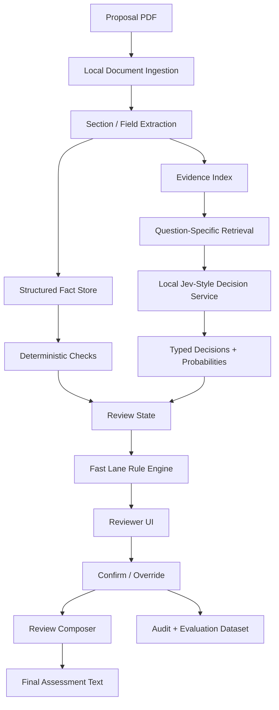

# Implementation Plan: Local Jev-Style Decision Assistant for EuroHPC AI Technical Reviews

**Document purpose:** Implementation specification for development agents
**Target workflow:** EuroHPC/LUMI AI technical review assistance
**Primary design goal:** Keep confidential proposal content and personal data inside an approved local environment while providing fast, evidence-backed assistance for manual review decisions.

---

## 1. Executive Summary

The current review application is useful for applying review rules and producing standardized text, but it still requires the reviewer to manually inspect proposals and answer several technical questions. The proposed extension adds a **fully local decision-assistance layer** based on a lightweight Jev-style decision model.

The system should not attempt to replace the technical reviewer. Its role is to:

1. extract relevant facts from a proposal;
2. retrieve the evidence needed for each review question;
3. use a local decision model to score bounded semantic questions;
4. apply deterministic review rules separately from model reasoning;
5. expose the evidence, decision, confidence, and rule outcome to the reviewer;
6. let the reviewer confirm or override every material decision;
7. generate the final review only after human confirmation.

The recommended architecture is:

```text
Proposal PDF
    ↓
Local parser / section extractor
    ↓
Structured facts + searchable evidence store
    ↓
Question-specific evidence retrieval
    ↓
Local Jev-style decision service
    ↓
YES / NO / UNKNOWN + confidence + evidence
    ↓
Deterministic Fast Lane rule engine
    ↓
Reviewer confirmation / override
    ↓
Templated technical assessment
```

The initial implementation should be deliberately conservative. The most important safety rule is:

> **No model-generated decision may become an automatic rejection without explicit deterministic evidence or reviewer confirmation.**

The model layer must be pluggable. The first development milestone should benchmark several local Jev-style approaches on historical completed reviews rather than committing immediately to one model.

---

## 2. Problem Definition

### 2.1 Current limitation

The review workflow includes decisions such as:

- Is the proposed software suitable for LUMI-G?
- Does the software have an AMD/ROCm execution path?
- Has the code previously been installed or demonstrated on LUMI?
- Is the workplan sufficiently detailed?
- Can the requested GPU allocation be consumed within the project duration?
- Is the proposed scaling strategy technically plausible?
- Are there technical blockers requiring rejection or clarification?

Some of these are deterministic, while others require contextual interpretation of several parts of the proposal.

A rule-only application therefore has two weaknesses:

1. the reviewer must manually locate relevant information;
2. missing or ambiguous evidence may be incorrectly treated as a negative answer.

A general hosted LLM could improve contextual interpretation, but confidential proposals and personal information must not be transmitted to an external inference provider.

### 2.2 Proposed solution

Add a **local evidence extraction and typed decision layer**.

The local model should answer narrowly defined questions from proposal evidence rather than generating a free-form review from the full document.

For example:

```text
QUESTION
Does the proposed software stack have a plausible AMD/ROCm execution path?

EVIDENCE
- "PyTorch (ROCm)"
- "Target environment: Python and PyTorch with the ROCm backend."
- "Training will target PyTorch/ROCm on LUMI-G."

OUTPUT
YES = 0.97
NO = 0.03
RESULT = YES
```

The reviewer should see both the answer and the evidence used to derive it.

---

## 3. Goals and Non-Goals

### 3.1 Goals

The system shall:

- run entirely inside an approved local environment;
- make no external inference API calls;
- extract structured facts from proposal PDFs;
- retrieve question-specific supporting passages;
- provide typed decisions such as `YES`, `NO`, `UNKNOWN`, `CHOICE`, or `SCORE`;
- expose confidence and supporting evidence;
- apply Fast Lane rules deterministically where possible;
- retain the reviewer as the final decision authority;
- support auditability and reproducibility;
- improve review speed without reducing review quality;
- allow model replacement without redesigning the application;
- support future Playground and Large Scale rule profiles.

### 3.2 Non-goals

The first version shall not:

- autonomously approve or reject applications;
- replace reviewer judgment;
- infer eligibility information when structured fields are available;
- use external hosted LLM APIs;
- generate long free-form reasoning;
- train a new foundation model;
- depend on chain-of-thought generation;
- make cryptographic, legal, ethical, or scientific merit judgments beyond the review rubric;
- treat low model confidence as evidence for rejection.

---

## 4. Core Design Principles

### 4.1 Deterministic facts first

Use ordinary parsing and code for facts such as:

- organization type;
- VAT number presence;
- target system;
- requested GPU hours;
- maximum number of GPUs;
- project duration;
- storage;
- data transfer;
- previous EuroHPC allocation;
- personal-data declaration.

Do not use a model when a value can be read from a structured field.

### 4.2 Models handle semantic interpretation

Use the decision model for questions such as:

- whether a described software stack is plausibly AMD/ROCm compatible;
- whether the stated scaling method is appropriate;
- whether the workplan contains enough technical detail;
- whether a stated optimization plan is credible for the requested access mode.

### 4.3 Evidence precedes judgment

A decision request should always be built from retrieved proposal evidence.

The model should never receive only:

```text
"Is this software compatible with LUMI-G?"
```

It should receive the question plus the passages that support or contradict the answer.

### 4.4 Three-state decisions

Internally use:

```text
YES
NO
UNKNOWN
```

even when the external review form ultimately requires `YES` or `NO`.

`UNKNOWN` means the proposal does not provide enough evidence for a reliable model recommendation.

### 4.5 Rules and model decisions remain separate

The model reports semantic judgments.

The rule engine decides what those judgments mean under the applicable access mode.

Example:

```text
software_gpu_capable = UNKNOWN
```

must not silently become:

```text
classification = REJECT
```

Instead:

```text
reviewer_attention = REQUIRED
```

### 4.6 Human confirmation is mandatory

The reviewer must be able to:

- accept a suggested answer;
- change it;
- inspect evidence;
- add a short note;
- mark a question as unresolved.

Reviewer overrides should be logged for later model evaluation.

---

## 5. Proposed System Architecture



### 5.1 Trust boundaries

Everything from PDF ingestion through final review generation should execute within the approved environment.

The runtime must not:

- call external AI APIs;
- send telemetry containing proposal content;
- upload documents to model hubs during inference;
- fetch model files dynamically in production.

Model weights and dependencies should be staged beforehand.

---

## 6. Component Design

## 6.1 Document Ingestion Service

### Responsibilities

- accept a proposal PDF;
- compute a document hash;
- extract text and page boundaries;
- identify known form headings;
- preserve page references;
- optionally extract tables or key-value fields;
- detect likely extraction failures.

### Recommended output

```json
{
  "document_id": "sha256:...",
  "pages": [
    {
      "page": 1,
      "text": "...",
      "blocks": []
    }
  ],
  "sections": {
    "project_summary": "...",
    "ai_factory_selection": "...",
    "code_details": "...",
    "scalability_and_performance": "...",
    "ethics": "..."
  }
}
```

### Parsing strategy

Use the simplest reliable local parser first.

Preferred order:

1. embedded PDF text;
2. layout-aware extraction if needed;
3. OCR only for pages without usable text.

Do not OCR all pages by default.

---

## 6.2 Structured Fact Extractor

This component should parse form-like values using deterministic patterns and section context.

### Initial fact schema

```yaml
application:
  application_id:
  access_mode:
  target_machine:
  project_duration_months:

organization:
  organization_type:
  country:
  vat_number_present:
  vat_number:

resources:
  requested_gpu_hours:
  maximum_number_of_gpus:
  total_storage_gb:
  total_transfer_gb:

software:
  listed_codes:
  framework_names:
  backend_mentions:
  previous_lumi_use:

data:
  personal_data_declared:
```

### Important rule

Store both:

```yaml
value: 50000
source:
  page: 5
  field: "Requested amount of resources (GPU hours)"
  text: "50000"
```

Every material fact should have traceable provenance.

---

## 6.3 Evidence Index

The evidence layer should make proposal passages retrievable by review question.

Because proposals are relatively short and structured, begin with a lightweight local retrieval approach.

### Retrieval hierarchy

1. known section targeting;
2. exact keyword / lexical retrieval;
3. BM25 or equivalent local ranking;
4. optional local embedding retrieval if lexical search is insufficient.

### Example question retrieval profile

```yaml
software_gpu_capable:
  preferred_sections:
    - "Code(s) used"
    - "Code Details and Feasibility"
    - "Description of the code"
    - "Scalability and performance"

  keywords:
    - ROCm
    - AMD
    - CUDA
    - PyTorch
    - TensorFlow
    - JAX
    - GPU
    - accelerator
    - MI250X
    - LUMI-G
```

### Output

```json
{
  "question_id": "software_gpu_capable",
  "evidence": [
    {
      "page": 5,
      "section": "AI Factory selection",
      "text": "Code(s) used: PyTorch (ROCm), ..."
    },
    {
      "page": 6,
      "section": "Description of the code",
      "text": "Neural training will target PyTorch/ROCm on LUMI-G."
    }
  ]
}
```

Keep evidence chunks short enough for the decision model to focus on the relevant information.

---

## 6.4 Local Jev-Style Decision Service

The decision service converts:

```text
state/evidence + typed question
```

into:

```text
typed answer + probability distribution
```

### Required interface

```json
POST /v1/decide
{
  "question_id": "software_gpu_capable",
  "state": "...retrieved proposal evidence...",
  "question": {
    "type": "choice",
    "options": ["YES", "NO", "UNKNOWN"],
    "instructions": "...",
    "criteria": {
      "YES": "...",
      "NO": "...",
      "UNKNOWN": "..."
    }
  }
}
```

Response:

```json
{
  "question_id": "software_gpu_capable",
  "answer": "YES",
  "probabilities": {
    "YES": 0.95,
    "NO": 0.02,
    "UNKNOWN": 0.03
  },
  "confidence": 0.95,
  "model": "local-decision-model-v1",
  "latency_ms": 84
}
```

### Model abstraction

Implement a provider-neutral interface:

```python
class DecisionBackend:
    def decide(self, state, question) -> DecisionResult:
        ...
```

Candidate backends may include:

- a small local Jev-inspired binary classifier;
- a local OpenJev implementation;
- a 4B decision model;
- a masked-logit local LLM baseline;
- a future internally fine-tuned decision model.

Do not tie application logic directly to one repository or model.

---

## 7. Recommended Model Evaluation Strategy

There are now several independent local Jev-inspired implementations, but they differ substantially in model size, supported decision types, calibration, runtime, and maturity.

Therefore:

> **Do not select a production model before an internal benchmark on historical EuroHPC reviews.**

### 7.1 Candidate classes

Benchmark at least:

#### Candidate A — very small CPU decision model

Use for:

- binary questions;
- high throughput;
- low latency;
- simple evidence-based judgments.

Advantages:

- minimal infrastructure;
- inexpensive;
- fully local.

Risk:

- may miss nuanced HPC software reasoning.

#### Candidate B — local 4B decision model

Use for:

- richer technical interpretation;
- multiple-choice decisions;
- more complex workplan judgments.

Advantages:

- stronger language understanding;
- still small enough for modest GPU deployment.

Risk:

- higher latency and memory use.

#### Candidate C — masked-logit small LLM baseline

Use a standard local 1B–4B instruct model and score constrained answer tokens.

Purpose:

- establish whether a specialized decision model actually adds value.

### 7.2 Selection criteria

Select based on the internal review dataset using:

- decision accuracy;
- false-rejection rate;
- false-acceptance rate;
- `UNKNOWN` quality;
- calibration;
- evidence sensitivity;
- robustness to question wording;
- latency;
- CPU/GPU requirements;
- operational simplicity.

For this application, **false rejection should receive a significantly higher penalty than a low-confidence referral to the reviewer**.

---

## 8. Initial Decision Registry

Implement questions as versioned configuration rather than hard-coded prompts.

Example:

```yaml
questions:

  software_gpu_capable:
    type: choice
    options: [YES, NO, UNKNOWN]
    instructions: >
      Determine whether the proposed core software stack has a plausible
      execution path on AMD GPUs used by LUMI-G.
    criteria:
      YES: >
        The proposal explicitly states ROCm/AMD support, uses a framework
        with an AMD/ROCm execution path, or provides credible evidence of
        AMD GPU execution.
      NO: >
        A required core dependency is explicitly CUDA-only or the proposal
        establishes that AMD GPUs are unsupported.
      UNKNOWN: >
        The software or dependencies are insufficiently described to
        establish either compatibility or incompatibility.

  code_previously_installed:
    type: choice
    options: [YES, NO, UNKNOWN]
    instructions: >
      Determine whether the applicant demonstrates that the relevant code
      or environment has previously been installed or used on LUMI.
    criteria:
      YES: >
        Prior LUMI execution or explicit installation is stated, or only a
        standard already-available environment is required.
      NO: >
        The proposal states no prior LUMI use and requires custom or
        non-trivial code installation.
      UNKNOWN: >
        Prior installation cannot be established from the evidence.

  workplan_sufficient:
    type: choice
    options: [YES, NO, UNKNOWN]
    instructions: >
      Determine whether the technical workplan contains enough information
      to assess feasibility for the requested Fast Lane allocation.
    criteria:
      YES: >
        The proposal provides concrete goals plus a plausible execution,
        scaling, benchmarking, or experiment plan linked to the requested
        resources.
      NO: >
        The proposal lacks sufficient information to understand how the
        requested compute will be used or how the technical objectives will
        be executed.
      UNKNOWN: >
        Some workplan information is present but important feasibility
        information remains unresolved.

  scaling_strategy_adequate:
    type: choice
    options: [YES, NO, UNKNOWN]
    instructions: >
      Determine whether the proposed scaling approach can make meaningful
      use of the requested maximum concurrency.
    criteria:
      YES: >
        The proposal describes multi-node distributed execution or a valid
        embarrassingly-parallel/job-array strategy matching the requested
        concurrency.
      NO: >
        The requested scale requires parallel execution but the proposed
        application cannot use it.
      UNKNOWN: >
        The relationship between workload and requested concurrency is not
        sufficiently described.
```

All question definitions should have a `version`.

---

## 9. Confidence and UNKNOWN Policy

Never derive operational decisions directly from the highest probability alone.

Initial policy:

```yaml
high_confidence: 0.85
review_band: 0.65
```

Suggested interpretation:

```text
max probability >= 0.85
    → show model recommendation prominently

0.65 <= max probability < 0.85
    → show recommendation as "review advised"

max probability < 0.65
    → convert to UNKNOWN / reviewer required
```

These thresholds must be calibrated using historical reviews.

### Margin check

Also compute:

```text
margin = P(top1) - P(top2)
```

A high top probability with a small margin should still be treated cautiously.

---

## 10. Deterministic Fast Lane Rule Engine

The rule engine should be independent of the model.

### 10.1 Software compatibility

Illustrative logic:

```python
if software_gpu_capable == "NO":
    technical_blocker = True

elif software_gpu_capable == "UNKNOWN":
    reviewer_attention = True

else:
    continue_review = True
```

The actual classification must remain aligned with the current internal review policy.

### 10.2 Installation

`code_installed = NO` is not by itself a rejection.

It should affect:

- startup risk;
- review wording;
- workplan confidence.

### 10.3 Multi-node / concurrency suitability

If requested concurrency exceeds one LUMI-G node, assess whether the workload supports either:

- distributed multi-node execution; or
- independent concurrent jobs/job arrays.

Do not require distributed data parallelism when embarrassingly parallel execution is sufficient.

### 10.4 Resource consumption feasibility

Implement the resource feasibility test deterministically.

Conceptually:

```python
minimum_months_at_max_concurrency = (
    requested_gpu_hours /
    (maximum_number_of_gpus * 24 * 30)
)
```

If:

```python
minimum_months_at_max_concurrency > project_duration_months
```

then the request cannot be consumed even with continuous utilization at the declared maximum concurrency.

Return:

```yaml
resource_consumption_feasible: false
severity: blocker
evidence:
  requested_gpu_hours:
  maximum_number_of_gpus:
  project_duration_months:
  computed_minimum_months:
```

### 10.5 Storage

Implement a deterministic storage warning threshold according to current review policy.

Example:

```text
total_storage > scratch capacity threshold
    → warning / storage-plan review
```

Do not automatically reject solely because a larger storage tier may be required.

### 10.6 Personal data

If the proposal declares personal-data processing:

```text
personal_data_declared = true
```

surface the required workflow and standard review wording.

This should be a deterministic flag.

### 10.7 Eligibility fields

Fields such as VAT should be read directly from the application.

Use:

```yaml
vat_number:
  value: ...
  status: PRESENT | ABSENT | PARSE_ERROR
```

Never infer:

```text
PARSE_ERROR → ABSENT
```

A parsing failure must trigger reviewer verification.

---

## 11. Review State Schema

Use one canonical object representing the review.

```json
{
  "application_id": "...",
  "access_mode": "FAST_LANE",

  "facts": {
    "requested_gpu_hours": {
      "value": 50000,
      "source": {"page": 5}
    }
  },

  "decisions": {
    "software_gpu_capable": {
      "model_answer": "YES",
      "probabilities": {
        "YES": 0.96,
        "NO": 0.01,
        "UNKNOWN": 0.03
      },
      "reviewer_answer": null,
      "effective_answer": "YES",
      "evidence_ids": ["ev-12", "ev-17"],
      "question_version": "1.0"
    }
  },

  "rules": {
    "resource_consumption_feasible": {
      "result": true,
      "calculation": {}
    }
  },

  "classification": {
    "suggested": "ACCEPT",
    "reviewer_final": null
  }
}
```

---

## 12. Reviewer UI

The reviewer interface is central to the design.

### 12.1 Question card

Each manual question should display:

```text
Software suitable for LUMI-G?

Suggested answer: YES
Confidence: High

Evidence:
[Page 5] "..."
[Page 6] "..."

Why this question matters:
Fast Lane requires a plausible AMD/ROCm execution path.

[Confirm YES] [NO] [UNKNOWN] [View more evidence]
```

### 12.2 Separate evidence from interpretation

The UI should visually distinguish:

- **Extracted fact**
- **Proposal evidence**
- **Model recommendation**
- **Deterministic rule**
- **Reviewer decision**

The reviewer should never have to guess which layer produced a statement.

### 12.3 Contradiction warning

If the model says `NO` but proposal evidence includes strong positive terms such as explicit ROCm support, display:

```text
⚠ Possible evidence/decision contradiction
```

and require reviewer confirmation.

### 12.4 Missing-data warning

Example:

```text
VAT status: PARSE_ERROR
Reviewer verification required.
```

not:

```text
VAT number missing.
```

---

## 13. Review Composer

The final review should be generated primarily from templates.

Example:

```jinja2
## Are the codes suitable for the architecture?

**{{ software_answer | lower }}**

{{ software_comment }}
```

The short comment can be selected or parameterized from structured facts.

Example:

```text
The software stack uses {{ framework }} with {{ backend }} and appears
suitable for LUMI-G. Prior execution on LUMI has not been demonstrated.
```

Avoid unconstrained generative text in the first production version.

A local small language model may later be used for stylistic polishing, but only after all facts and decisions are fixed.

---

## 14. Security and Privacy Requirements

Because the primary motivation for local inference is confidentiality, these requirements are mandatory.

### 14.1 Runtime isolation

Production inference should support:

- no outbound internet;
- local model weights;
- local tokenizer;
- local evidence store;
- no cloud telemetry;
- no external crash-report submission.

### 14.2 Model staging

Model weights should be downloaded and security-reviewed before deployment.

Production containers should reference local artifacts.

Do not allow runtime model downloads.

### 14.3 Logging

Logs must not contain complete proposal text by default.

Log:

- application ID;
- question ID;
- model version;
- answer probabilities;
- evidence IDs;
- latency;
- reviewer override.

Do not log:

- full proposal content;
- personal contact details;
- unnecessary evidence text.

### 14.4 Data retention

Define retention independently for:

- uploaded proposal;
- parsed text;
- extracted facts;
- decision state;
- reviewer audit data;
- benchmark dataset.

Follow organizational requirements.

### 14.5 Access control

Only authorized reviewers and maintainers should access proposal data.

Separate:

- reviewer permissions;
- model/runtime administration;
- benchmark/evaluation access.

### 14.6 Offline verification

Add an integration test that fails if the review service attempts outbound network access during inference.

---

## 15. Evaluation Dataset

Before production use, create an internal gold-standard dataset from previously completed reviews.

### 15.1 Record structure

```json
{
  "application_id": "historical-id",
  "access_mode": "FAST_LANE",

  "gold": {
    "software_gpu_capable": "YES",
    "code_installed": "NO",
    "workplan_sufficient": "YES",
    "workplan_feasible": "YES",
    "classification": "ACCEPT"
  },

  "reviewer_notes": "...",
  "evidence": {
    "software_gpu_capable": [...]
  }
}
```

### 15.2 Suggested size

Prototype:

```text
30–50 reviewed applications
```

Model-selection benchmark:

```text
100+ applications if available
```

Include:

- straightforward accepts;
- technical rejects;
- insufficient-detail cases;
- CUDA-only software;
- explicit ROCm stacks;
- custom/private software;
- job-array workloads;
- multi-node distributed workloads;
- proposals with missing fields;
- proposals with ambiguous wording.

### 15.3 Avoid leakage

Do not tune thresholds on the same complete dataset used for final evaluation.

Use:

```text
development set
validation set
held-out review set
```

---

## 16. Evaluation Metrics

### 16.1 Per-question metrics

Measure:

- accuracy;
- precision;
- recall;
- F1;
- confusion matrix;
- abstention/UNKNOWN rate;
- accuracy conditional on high confidence.

### 16.2 Review-specific risk metrics

Track separately:

```text
False technical rejection
False technical acceptance
Incorrect UNKNOWN
Correct reviewer escalation
```

False rejection should be considered the more severe model error.

### 16.3 Calibration

For decisions reported at approximately 90% confidence, check whether they are actually correct approximately 90% of the time.

Use:

- Expected Calibration Error;
- Brier score;
- reliability plots.

### 16.4 Retrieval quality

Measure:

- evidence recall;
- evidence precision;
- whether the decisive passage appears in top-k retrieval.

A decision model cannot compensate reliably for missing evidence.

### 16.5 Operational metrics

Measure:

- median latency/question;
- p95 latency;
- memory use;
- CPU/GPU utilization;
- document processing time;
- reviewer time saved.

---

## 17. Model Robustness Tests

Before deployment, test:

### 17.1 Prompt paraphrase robustness

Ask the same question using several equivalent phrasings.

The decision should remain stable.

### 17.2 Evidence removal

Remove the decisive sentence.

Confidence should decrease or the output should become `UNKNOWN`.

### 17.3 Contradictory evidence

Provide:

```text
"Framework uses ROCm"
```

and:

```text
"Required custom extension is CUDA-only"
```

The system should not return a highly confident positive without review.

### 17.4 Irrelevant text

Add unrelated proposal sections.

The decision should remain stable.

### 17.5 Negation

Test:

```text
"does not support ROCm"
```

versus:

```text
"supports ROCm"
```

### 17.6 Missing information

An undocumented software stack should result in `UNKNOWN`, not `NO`.

---

## 18. API Design

Recommended internal endpoints:

```text
POST /api/documents
POST /api/documents/{id}/extract
GET  /api/documents/{id}/facts
GET  /api/documents/{id}/evidence/{question_id}

POST /api/reviews/{id}/decide
GET  /api/reviews/{id}
PATCH /api/reviews/{id}/decisions/{question_id}

POST /api/reviews/{id}/evaluate-rules
POST /api/reviews/{id}/compose
POST /api/reviews/{id}/finalize
```

### Decision endpoint

```json
POST /api/reviews/{id}/decide
{
  "question_ids": [
    "software_gpu_capable",
    "workplan_sufficient",
    "scaling_strategy_adequate"
  ]
}
```

Response:

```json
{
  "decisions": [
    {
      "question_id": "software_gpu_capable",
      "answer": "YES",
      "confidence": 0.94,
      "evidence": ["ev-12", "ev-17"],
      "model_version": "..."
    }
  ]
}
```

---

## 19. Suggested Repository Structure

```text
review-assistant/
├── app/
│   ├── api/
│   ├── ingestion/
│   ├── extraction/
│   ├── retrieval/
│   ├── decision/
│   │   ├── base.py
│   │   ├── jevos_backend.py
│   │   ├── openjev_backend.py
│   │   └── masked_lm_backend.py
│   ├── rules/
│   │   ├── base.py
│   │   ├── fast_lane.py
│   │   ├── playground.py
│   │   └── large_scale.py
│   ├── review/
│   ├── security/
│   └── schemas/
├── config/
│   ├── questions/
│   │   └── fast_lane.yaml
│   ├── thresholds.yaml
│   └── templates/
├── tests/
│   ├── unit/
│   ├── integration/
│   ├── regression/
│   └── evaluation/
├── evaluation/
│   ├── datasets/
│   ├── benchmarks/
│   └── reports/
├── deploy/
│   ├── container/
│   └── offline/
└── docs/
```

---

## 20. Implementation Phases

## Phase 0 — Baseline and requirements freeze

**Objective:** reproduce the current application behavior before introducing AI.

### Tasks

- document current manual questions;
- document current rule logic;
- identify all deterministic fields;
- export 30–50 historical completed reviews;
- define gold labels;
- define security boundary;
- define acceptable deployment hardware.

### Deliverables

- review schema;
- Fast Lane rule specification;
- benchmark dataset v0;
- baseline metrics.

### Exit criterion

The team can run the current review logic against stored test fixtures reproducibly.

---

## Phase 1 — Evidence extraction

**Objective:** surface useful proposal information without any decision model.

### Tasks

- implement PDF ingestion;
- implement section extraction;
- implement structured fact parser;
- implement evidence retrieval profiles;
- add page-level provenance;
- build reviewer evidence UI.

### Deliverable

For every manual review question, the reviewer sees relevant proposal excerpts.

### Exit criterion

On the benchmark dataset, decisive evidence appears in top-5 retrieved passages for at least 95% of cases.

---

## Phase 2 — Local decision backend bake-off

**Objective:** determine whether a local Jev-style model reliably answers the bounded review questions.

### Tasks

Implement adapters for:

- lightweight CPU binary decision model;
- local 4B decision model;
- masked-logit small-LLM baseline.

Run all candidates on the same historical dataset.

### Deliverables

Benchmark report including:

- accuracy;
- false-rejection rate;
- calibration;
- latency;
- resource use;
- per-question performance.

### Exit criterion

At least one candidate clearly improves reviewer assistance over the non-model baseline without unacceptable false rejection.

---

## Phase 3 — Decision integration

**Objective:** add model recommendations to the reviewer UI.

### Tasks

- add versioned question registry;
- add decision service;
- add YES/NO/UNKNOWN policy;
- add confidence thresholds;
- attach evidence to every decision;
- add contradiction checks;
- add reviewer confirmation and override.

### Exit criterion

No decision can reach final review output without traceable evidence and reviewer confirmation.

---

## Phase 4 — Deterministic rule engine

**Objective:** enforce Fast Lane rules independently of model output.

### Tasks

Implement:

- resource-consumption formula;
- storage warnings;
- previous-LUMI-use logic;
- personal-data flag;
- software suitability rule;
- concurrency/scaling checks;
- classification recommendation;
- reviewer-attention states.

### Exit criterion

All deterministic historical cases reproduce the expected rule result.

---

## Phase 5 — Review composition

**Objective:** generate concise assessment text from confirmed facts.

### Tasks

- create acceptance templates;
- create rejection templates;
- parameterize comments;
- verify contact text/configuration;
- ensure no unsupported fact enters the generated review.

### Exit criterion

Generated reviews require only minor stylistic editing in normal cases.

---

## Phase 6 — Security hardening

### Tasks

- package model weights locally;
- disable outbound network;
- disable telemetry;
- review logging;
- test temporary-file cleanup;
- implement access control;
- create offline deployment instructions;
- perform dependency/license review.

### Exit criterion

A complete review can be executed with network egress disabled.

---

## Phase 7 — Shadow deployment

Run the system alongside the existing workflow.

The local model must not affect submitted outcomes during this phase.

Collect:

- agreement with reviewers;
- overrides;
- incorrect evidence;
- latency;
- reviewer time savings.

Recommended shadow period:

```text
20–50 live reviews
```

---

## Phase 8 — Controlled production

Enable model recommendations by default, but preserve mandatory reviewer confirmation.

Do not initially enable autonomous acceptance or rejection.

---

## 21. Development Work Packages

The following can be assigned independently to development agents.

### WP1 — Document and fact extraction

Build:

- PDF parser;
- form field extraction;
- provenance model;
- extraction tests.

**Definition of done:** all core numerical and administrative fields are parsed reliably from historical applications.

### WP2 — Evidence retrieval

Build:

- question retrieval profiles;
- lexical/BM25 index;
- evidence ranking;
- page references.

**Definition of done:** decisive evidence recall target reached.

### WP3 — Local decision service

Build:

- `DecisionBackend` interface;
- candidate model adapters;
- typed response schema;
- batching;
- latency metrics.

**Definition of done:** all configured questions can be evaluated locally without internet access.

### WP4 — Benchmarking

Build:

- evaluation runner;
- historical dataset loader;
- accuracy/calibration reports;
- model-comparison report.

**Definition of done:** recommended model/backend selected using explicit metrics.

### WP5 — Rule engine

Build:

- versioned Fast Lane rule set;
- deterministic calculations;
- classification state;
- blocker/warning/reviewer-attention severity.

**Definition of done:** regression tests cover every rule branch.

### WP6 — Reviewer UI

Build:

- evidence cards;
- decision confidence;
- confirm/override controls;
- contradiction warnings;
- unresolved-state handling.

**Definition of done:** reviewer can complete the technical assessment without searching the PDF for routine facts.

### WP7 — Review generation

Build:

- templates;
- classification reason composer;
- configurable support/contact text;
- final validation.

**Definition of done:** every generated statement can be traced to a confirmed fact or rule.

### WP8 — Security and deployment

Build:

- offline container;
- local model staging;
- no-egress tests;
- retention controls;
- logging policy.

**Definition of done:** service runs successfully in the approved environment with outbound network disabled.

---

## 22. Testing Strategy

### Unit tests

Test:

- numeric extraction;
- VAT presence;
- resource formula;
- decision schema validation;
- confidence threshold logic;
- rule transitions.

### Regression tests

Each historical review becomes a fixture.

Example:

```text
fixture_001:
  expected.software_gpu_capable = YES
  expected.code_installed = NO
  expected.workplan_feasible = YES
  expected.classification = ACCEPT
```

### Integration tests

Test full flow:

```text
PDF → extraction → evidence → decisions → rules → UI state → review text
```

### Security tests

Verify:

- no network egress;
- no model download;
- no sensitive text in logs;
- proposal cleanup after retention period.

---

## 23. Production Acceptance Criteria

The system should not be promoted from shadow mode until all mandatory criteria are met.

### Functional

- every decision includes supporting evidence;
- reviewer can override every model recommendation;
- `UNKNOWN` is supported;
- deterministic facts do not depend on LLM inference;
- rule engine is independent of model backend.

### Quality

Recommended initial targets:

```text
Evidence top-5 recall                  >= 95%
High-confidence decision accuracy      >= 95%
False-rejection recommendation rate    < 1%
Structured-field extraction accuracy   >= 99%
```

These are starting targets and should be validated against actual review difficulty.

### Privacy

- no proposal content leaves the approved environment;
- all inference is local;
- no production runtime download is required;
- logs are privacy-reviewed.

### Operational

- median question latency acceptable for interactive use;
- complete proposal preprocessing should be short enough not to interrupt reviewer workflow;
- model service recovers gracefully after restart;
- model/version information is recorded for each assessment.

---

## 24. Failure Handling

### Extraction failure

Return:

```text
PARSE_ERROR
```

Do not convert to an absent field.

### Retrieval failure

Return:

```text
NO_EVIDENCE_FOUND
```

and route to reviewer.

### Model uncertainty

Return:

```text
UNKNOWN
```

or reviewer-attention state.

### Model/runtime failure

The application must remain usable with manual answers and deterministic rules.

The decision model is an enhancement, not a single point of failure.

### Contradiction

If high-confidence model output conflicts with strong structured evidence:

```text
status = CONTRADICTION
```

Require human resolution.

---

## 25. Auditability

For each submitted review retain, subject to retention policy:

```yaml
application_id:
review_timestamp:
reviewer:
application_hash:

extractor_version:
question_registry_version:
rule_version:
model_backend:
model_version:

decisions:
  - question_id:
    model_answer:
    confidence:
    evidence_ids:
    reviewer_answer:
    override_reason:

final_classification:
```

This allows future investigation of:

- why the model suggested a decision;
- whether a rule changed;
- whether a reviewer overrode the model;
- whether a model upgrade altered behavior.

---

## 26. Model Improvement Loop

Reviewer overrides are valuable supervised signals.

Create a periodic evaluation process:

```text
Reviewer override
    ↓
Curated correction dataset
    ↓
Offline benchmark
    ↓
Question/rule improvement
    ↓
Optional fine-tuning
    ↓
New model candidate
    ↓
Held-out validation
    ↓
Controlled rollout
```

Do not automatically train on every override. Corrections should first be reviewed for consistency.

Potential future adaptation:

- fine-tune a small local decision model on historical technical reviews;
- calibrate probabilities per question type;
- create separate decision heads for software compatibility and workplan sufficiency.

---

## 27. Recommended Initial Technical Choice

Do **not** start by fine-tuning.

Start with:

1. deterministic field extraction;
2. local evidence retrieval;
3. a pluggable Jev-style decision interface;
4. benchmark multiple local models;
5. select the smallest model that reaches the required review accuracy.

A sensible first bake-off is:

```text
A. CPU-scale yes/no Jev-inspired model
B. 4B local decision model
C. 1B–4B masked-logit instruct-model baseline
```

If A performs sufficiently well on software compatibility and workplan questions, prefer it because of its low operational cost.

If A fails on contextual technical questions but B succeeds, use a **tiered architecture**:

```text
deterministic rules
    ↓
small CPU decision model
    ↓ if uncertain
4B local decision model
    ↓ if still uncertain
reviewer
```

This keeps normal reviews inexpensive while preserving a stronger local fallback.

---

## 28. Future Extension: Hierarchical Decision Routing

After sufficient evaluation, introduce decision routing.

Example:

```text
Question: software_gpu_capable

Structured evidence contains explicit "ROCm"
    → deterministic YES candidate

No explicit backend, but known framework/dependencies described
    → lightweight Jev model

Complex custom stack / conflicting dependencies
    → 4B decision model

Low confidence or contradiction
    → reviewer
```

This is likely more reliable and efficient than forcing every question through the same model.

---

## 29. Success Criteria

The project succeeds when the reviewer experience changes from:

```text
Open proposal
Search manually
Interpret several sections
Answer app question
Repeat
```

to:

```text
Open proposal

Question:
Is the software suitable for LUMI-G?

Extracted evidence:
- ...
- ...

Suggested answer:
YES (94%)

Reviewer:
Confirm

Next question...
```

The final reviewer remains responsible for the technical assessment, but routine evidence discovery and bounded interpretation become local, fast, and auditable.

---

## 30. Immediate Development Backlog

### Sprint 1

- [ ] Freeze Fast Lane question schema.
- [ ] Freeze deterministic rule specification.
- [ ] Create `ReviewState` data model.
- [ ] Implement PDF/page text extraction.
- [ ] Implement core form-field extraction.
- [ ] Build 20 historical review fixtures.
- [ ] Implement question-specific evidence retrieval.

### Sprint 2

- [ ] Implement `DecisionBackend`.
- [ ] Integrate first local Jev-style backend.
- [ ] Integrate comparison baseline.
- [ ] Build offline evaluation runner.
- [ ] Add YES/NO/UNKNOWN support.
- [ ] Add confidence and margin calculation.
- [ ] Produce first benchmark report.

### Sprint 3

- [ ] Implement Fast Lane rule engine.
- [ ] Implement contradiction checks.
- [ ] Implement reviewer evidence cards.
- [ ] Add confirm/override workflow.
- [ ] Add audit records.

### Sprint 4

- [ ] Implement final review templates.
- [ ] Containerize offline runtime.
- [ ] Disable egress and telemetry.
- [ ] Run complete historical regression suite.
- [ ] Start shadow deployment.

---

## 31. Key Engineering Decisions to Preserve

Development agents should treat the following as architectural constraints:

1. **Proposal content stays local.**
2. **The model is replaceable.**
3. **Structured facts are extracted deterministically whenever possible.**
4. **Semantic decisions are evidence-conditioned.**
5. **UNKNOWN is a first-class state.**
6. **Confidence is advisory, not authority.**
7. **Rule logic is separate from model logic.**
8. **No automatic rejection from ambiguous model output.**
9. **Every recommendation is auditable.**
10. **Human confirmation remains the final gate.**

---

## 32. Public Implementations to Evaluate

The model layer should remain vendor-neutral, but the development team can evaluate recent local Jev-inspired implementations during Phase 2.

Examples available as of October 2026 include:

- TypeSafe AI Jev concept / System One models: `https://typesafe.ai/blog/introducing-system-one-models-and-jev`
- `jevos`, a local CPU-oriented yes/no decision implementation: `https://github.com/feder-cr/jev`
- OpenJev implementations that expose typed probability decisions over local models, e.g. `https://github.com/lookski/openjev`
- OpenJev-4B decision-model work: `https://github.com/ejhshen/OpenJev`

These projects are independent and should be treated as **candidate implementations, not interchangeable production equivalents**. Their accuracy, calibration, supported question types, licenses, hardware requirements, and security properties must be validated internally.

---

# Final Recommendation

Build the system as a **local evidence-driven decision assistant**, not as a local general-purpose chatbot.

The highest-value first implementation is:

```text
Deterministic proposal extraction
        +
Question-specific evidence retrieval
        +
Local Jev-style YES/NO/UNKNOWN decisions
        +
Deterministic Fast Lane rules
        +
Reviewer confirmation
```

This design directly addresses the current limitation of the review application while preserving confidentiality, reducing manual searching, keeping decisions auditable, and allowing the local decision model to remain small and efficient.
